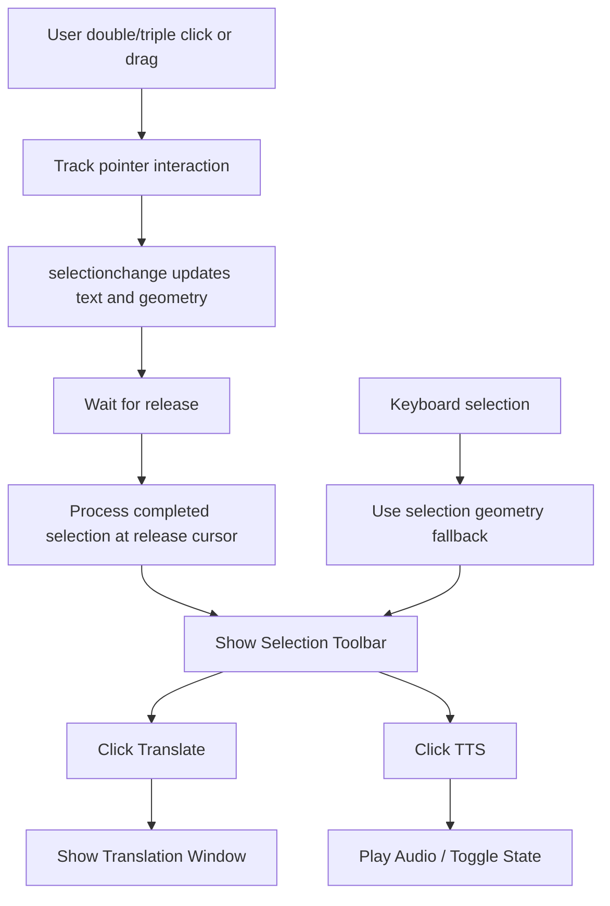

# Text Selection System

## Overview

The Text Selection system is a key component of the Translate-It extension, responsible for detecting, managing, and processing text selection on web pages. With a **Simplified Architecture** based on `selectionchange` events, it provides an optimized user experience for translating or pronouncing selected text.

### Updates - Selection Toolbar:
- **Icon to Toolbar Evolution**: The single "Translation Icon" has been refactored into a modular **Selection Toolbar** (pill-shaped icon group).
- **Multi-Action Support**: Supports both **Translate** and **Text-to-Speech (TTS)** actions directly from the initial selection trigger.
- **Configurable Visibility**: Users can toggle individual buttons (Translate/TTS) via settings.
- **Stateful Interaction**: The toolbar integrates with `useTTSSmart` to provide real-time playback states (loading, playing) within the selection UI.
- **Smart Dismissal**: TTS playback automatically stops when the toolbar is dismissed (e.g., clicking outside), ensuring audio doesn't leak after the UI is gone.

### Updates - Simplified System:
- **Selection and drag handling**: `selectionchange` tracks updated text and selection geometry; mouse and keyboard events provide interaction context and positioning.
- **Multi-click and drag completion**: Double-click word selection, triple-click paragraph selection, and native drag extensions across paragraphs wait until release before presenting the toolbar.
- **No behavior toggle**: Release-based handling is always enabled. Older persisted `ENHANCED_TRIPLE_CLICK_DRAG` values (`true` or `false`) are ignored; no storage migration is required.
- **Release positioning**: The toolbar is positioned about 10px below the release cursor, clamped to the viewport. While the selection continues visibly, its position is retained as text and selection geometry update; keyboard selection uses selection geometry as the positioning fallback.
- **Text Field Decoupling**: Text field logic has been moved to the `text-field-interaction` module.
- **Performance Boost**: 60-70% reduction in code complexity and improved performance.
- **Lifecycle and cancellation**: Existing handler ownership, cleanup, and cancellation behavior remain in place.

## Architecture

### Core Components

#### 1. **SimpleTextSelectionHandler**
`src/features/text-selection/handlers/SimpleTextSelectionHandler.js`

- Tracks `selectionchange` updates alongside pointer and keyboard interaction events.
- Tracks multi-click and drag completion through release.
- Prevents toolbar display within text fields.
- Communicates directly with the `SelectionManager`.

#### 2. **SelectionManager**
`src/features/text-selection/core/SelectionManager.js`

- Processes text selection simply.
- Calculates UI positioning for the toolbar.
- Interacts with `WindowsManager`.
- Supports iframe communication.

#### 3. **useTextSelection (Vue Composable)**
`src/features/text-selection/composables/useTextSelection.js`

- Vue composable for integration.
- Reactive state management.
- Simple interaction with `SimpleTextSelectionHandler`.

#### 4. **TextFieldDetector**
`src/features/text-field-interaction/utils/TextFieldDetector.js`

- Detects field types using site handlers.
- Determines the appropriate selection strategy.
- Correct `async/await` implementation for all operations.
- Cache management for performance optimization.

## Selection Strategy (Simplified)

### Selection and Release Strategy

Page selections combine selection updates with interaction events:

#### **Page Content**
```javascript
selectionchange → track selected text and geometry
mousedown / click / mouseup → track multi-click and drag lifecycle
release → process completed selection and position from release cursor
keyboard selection → process using selection geometry
```

### Toolbar Display Conditions:

1. **Text is selected** (`selectedText.trim()`)
2. **Pointer selection is complete** (wait for release after multi-click or drag extension)
3. **Not inside a text field** (`!isInTextField`)
4. **Ctrl key requirement** (if enabled)
5. **Select element mode is disabled** (`!selectModeActive`)
6. **At least one toolbar icon is enabled** (Translate or TTS)

### Separation of Concerns:

* **Page Text Selection** → `SimpleTextSelectionHandler`
* **Text Field Selection** → `TextFieldDoubleClickHandler` (Separate module)

## Drag Completion and Positioning

### Advantages of the New Approach

#### Selection lifecycle

```javascript
// Track selection changes and interaction state separately.
selectionchange → update selected text and geometry
mousedown / click → track pointer gesture and multi-click
mouseup → process completed gesture using release cursor

```

#### Release behavior

```javascript
// Keep the toolbar aligned with the user's completed interaction.
release → position about 10px below cursor, clamped to viewport
visible continuation → retain position while selection geometry updates
keyboard selection → fall back to selection geometry

```

### Lifecycle

The existing handler remains the lifecycle owner: it registers and removes its listeners through its established resource tracking and cancels pending work during cleanup. Selection processing still respects the existing cancellation and dismissal paths.

## Event Flow

### Event Flow



### Various Scenarios

#### 1. **Mouse Selection** (Double/triple click and drag extension)

```
double-click → select word; triple-click → select paragraph
  ↓
drag → extend native selection, including across paragraphs
  ↓
release → process completed selection and position toolbar below release cursor

```

#### 2. **Keyboard Selection** (Ctrl+A, Shift+Arrow)

```
selectionchange → update selection; use selection geometry to position toolbar

```

#### 3. **Text Field Selection** (INPUT/TEXTAREA)

```
selectionchange → isSelectionInTextField() = true → skip
  ↓
double-click in text field → TextFieldDoubleClickHandler → show toolbar/icon

```

## Text Field Integration (Separate Module)

### Decoupling Text Fields

Professional editors and text fields are now managed by a separate module:

#### Text Field Handler (`text-field-interaction` module)

```javascript
// TextFieldDoubleClickHandler for text fields
class TextFieldDoubleClickHandler {
  handleDoubleClick(event) {
    if (this.isTextField(event.target)) {
      const selectedText = this.getSelectedText();
      this.showTranslationUI(selectedText);
    }
  }

  isTextField(element) {
    // INPUT, TEXTAREA, contenteditable
    return element.tagName === 'INPUT' ||
           element.tagName === 'TEXTAREA' ||
           element.contentEditable === 'true';
  }
}

```

#### Professional Editors Support

* **Google Docs**: contenteditable detection
* **Microsoft Office**: iframe-based detection
* **Zoho Writer**: custom element detection
* **Notion**: block-based detection
* **WPS Office**: office suite detection

### Simplified Approach:

1. **Page content** → `SimpleTextSelectionHandler`
2. **Text fields** → `TextFieldDoubleClickHandler`
3. **Professional editors** → `TextFieldDoubleClickHandler` (via contenteditable)

## Integration with Other Systems

### WindowsManager Integration

```javascript
// TextSelectionManager → WindowsManager
const position = this._calculateSelectionPosition(selectedText);
const windowsManager = this._getWindowsManager();
await windowsManager.show('selection', {
  text: selectedText,
  position: position
});

```

### FeatureManager Integration

```javascript
// FeatureManager → TextSelectionHandler
const textSelectionHandler = featureManager.getFeatureHandler('textSelection');
if (textSelectionHandler?.isActive) {
  const manager = textSelectionHandler.getTextSelectionManager();
  // Use manager...
}

```

### IFrame Support

```javascript
// Cross-frame communication
if (window !== window.top) {
  // Send selection request to parent
  const message = {
    type: 'SELECTION_REQUEST',
    text: selectedText,
    position: position
  };
  window.parent.postMessage(message, '*');
}

```

## Error Handling

### Error Management

```javascript
try {
  await this._processSelectionChangeEvent(event);
} catch (rawError) {
  const error = await ErrorHandler.processError(rawError);
  await this.errorHandler.handle(error, {
    type: ErrorTypes.UI,
    context: 'text-selection',
    eventType: event?.type
  });
}

```

### Context Safety

```javascript
// Extension context validation
if (ExtensionContextManager.isContextError(error)) {
  this.logger.debug('Extension context invalidated, skipping selection processing');
  return;
}

```

## Performance Optimization

### Optimizations

#### 1. **Resource Tracking**

```javascript
class TextSelectionManager extends ResourceTracker {
  constructor() {
    super('text-selection-manager');
    // Automatic cleanup of timeouts, event listeners, etc.
  }
}

```

#### 2. **Dynamic Toolbar Scaling**
The Selection Toolbar (`TranslationIcon.vue`) calculates its width dynamically based on active settings (`SHOW_TTS_ICON_IN_TOOLBAR`, `SHOW_TRANSLATE_ICON_IN_TOOLBAR`). This ensures the `usePositioning` logic always aligns the "pill" correctly relative to the selection without overflow.

#### 3. **Duplicate Prevention**

```javascript
// Prevent duplicate processing
const isRecentDuplicate = selectedText === this.lastProcessedText && 
                         (currentTime - this.lastProcessedTime) < this.selectionProcessingCooldown;

if (isRecentDuplicate && this._isWindowVisible()) {
  return; // Skip duplicate
}

```

#### 3. **Efficient Event Handling**

```javascript
// Only process events when feature is active
if (!this.isActive || !this.textSelectionManager) return;

```

## Testing and Debugging

### Debug Information

```javascript
// Debug status
getStatus() {
  return {
    handlerActive: this.isActive,
    hasSelection: this.hasActiveSelection(),
    managerAvailable: !!this.textSelectionManager,
    isDragging: this.isDragging,
    pendingSelection: !!this.pendingSelection
  };
}

```

### Logging

```javascript
// Structured logging
this.logger.debug('Selection detected', {
  text: selection.toString().substring(0, 30),
  fieldType: detection.fieldType,
  selectionStrategy: detection.selectionStrategy,
  eventStrategy: detection.selectionEventStrategy
});

```

## Best Practices

### Recommendations

1. **Use Field Detection**: Always identify the field type.
2. **Respect User Interaction**: Wait for the user to complete their selection.
3. **Cross-Frame Compatibility**: Account for iframes.
4. **Error Resilience**: Always handle potential errors.
5. **Resource Cleanup**: Ensure resources are properly disposed.
6. **Performance**: Prevent redundant duplicate processing.

### ❌ Things to Avoid

1. **Timeout-Based Detection**: Avoid using timeouts for primary drag detection.
2. **Immediate Processing**: Do not process `selectionchange` immediately during a drag.
3. **Hard-Coded Delays**: Avoid using fixed/static delays.
4. **Memory Leaks**: Do not forget to clean up resources.
5. **Duplicate Events**: Manage duplicate events properly.

## Usage Examples

### 1. **Regular Website Selection**

```javascript
// User double-clicks a word or triple-clicks a paragraph, then extends selection
// → selectionchange updates the selection while the gesture is active
// → On release: process the completed selection and position from the cursor

```

### 2. **Google Docs Selection** ```javascript

// User double-clicks in Google Docs
// → handleDoubleClick triggered
// → Direct processing with professional editor logic

```

### 3. **Keyboard Selection**
```javascript
// User presses Ctrl+A or extends selection with the keyboard
// → selectionchange updates the selection
// → Use selection geometry as the toolbar positioning fallback

```

## References

### Core Components (Simplified)

* **SimpleTextSelectionHandler**: `src/features/text-selection/handlers/SimpleTextSelectionHandler.js`
* **SelectionManager**: `src/features/text-selection/core/SelectionManager.js`
* **useTextSelection (Vue)**: `src/features/text-selection/composables/useTextSelection.js`

### Text Field Integration

* **TextFieldHandler**: `src/features/text-field-interaction/handlers/TextFieldHandler.js`
* **TextFieldDoubleClickHandler**: `src/features/text-field-interaction/handlers/TextFieldDoubleClickHandler.js`
* **TextFieldIconManager**: `src/features/text-field-interaction/managers/TextFieldIconManager.js`

### Documentation

* **WindowsManager**: `docs/technical/WINDOWS_MANAGER_UI_HOST_INTEGRATION.md`
* **Smart Handler Registration**: `docs/technical/SMART_HANDLER_REGISTRATION_SYSTEM.md`
* **Error Management**: `docs/technical/ERROR_MANAGEMENT_SYSTEM.md`

### Key Improvements - Simplification

* **Unified Selection Handling**: Selection updates, pointer gestures, release, and keyboard geometry are used together.
* **Multi-click Drag Completion**: Double-click, triple-click, and native drag extension wait for release before toolbar display.
* **Stable Positioning**: Release cursor position is retained for visible continuation; keyboard selections use selection geometry.
* **Text Field Separation**: Fully decoupled text fields into an independent module.
* **Performance Boost**: Higher efficiency with fewer race conditions.
* **Maintainability**: Cleaner, more readable code.
* **Cross-browser Reliability**: Improved compatibility across all major browsers.
